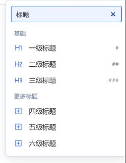
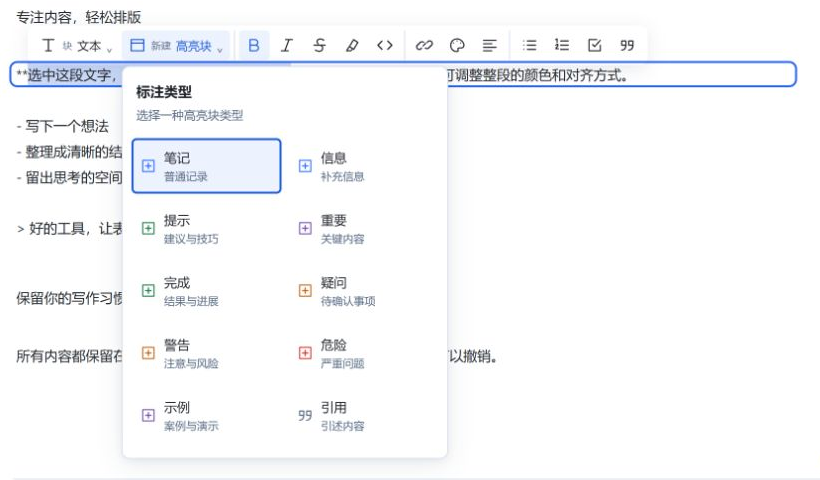

# Flow Edit · 流式编辑

为 Obsidian 提供斜杠插入、块操作和选区格式工具。建议使用「实时预览」。

## 插件功能

- **斜杠插入**：标题、列表、任务、引用、代码、表格、图片、链接、公式和高亮块。
- **块操作**：转换类型、剪切、复制、创建副本、上下移动、删除及复制块链接。
- **文字格式**：加粗、斜体、删除线、高亮、行内代码和链接。
- **块排版**：设置整块文字色、背景色和对齐，调整列表缩进。
- **高亮块**：创建或切换 Callout 类型，保留标题和正文。

### 功能截图

基于 0.0.1 源码的浏览器演示，展示编辑控件。

| 内容插入 | 块操作 |
| --- | --- |
|  |  |

## 使用方法

### 安装与升级

1. 从 [Releases](https://github.com/Beta-Zheng/flow-edit/releases) 下载同一版本的 `main.js`、`manifest.json` 和 `styles.css`。
2. 将三个文件放入 `<笔记库>/.obsidian/plugins/flow-edit/`。使用自定义配置目录时，替换其中的 `.obsidian`。
3. 在「设置 → 第三方插件」中启用 **Flow Edit**。未出现时重启 Obsidian。

升级时先停用插件，覆盖这三个文件，保留 `data.json`，再启用。旧开发版 `0.1.x`–`0.3.x` 也需手动覆盖安装。

### 编辑

- **插入内容**：空行输入 `/`，输入关键词筛选；方向键选择，Enter 插入，Escape 关闭。若与核心「斜杠命令」冲突，请停用核心插件。
- **设置文字格式**：选中文字并松开鼠标，点击浮动工具栏；再次点击已启用的文字格式可取消。
- **操作整块**：点击正文左侧手柄，或右键选择「Flow Edit · 块操作」。边距不足时可使用右键菜单。
- **调整排版**：在工具栏或块菜单中设置颜色、背景和对齐；这些设置作用于整个块。
- **使用高亮块**：点击工具栏「新建 · 高亮块」；已有高亮块可通过「标注 · 当前类型」或左侧图标切换类型。

复杂嵌套内容建议直接编辑 Markdown 源码；代码、公式和表格不支持通过菜单整体转换类型。
